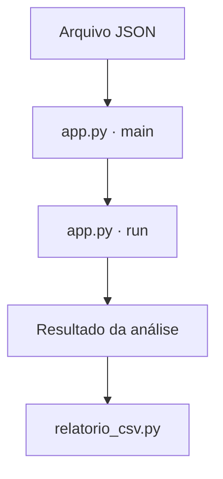

# Engenharia reversa e estudo — Catálogo de comentários bíblicos

## Objetivo e fluxo

Busca de comentários e obras de referência por livro. app.py aplica os filtros e trata a URL fornecida da editora como campo do registro. relatorio_csv.py traduz os resultados para uma tabela.

**Tecnologias identificadas** · Python.

**Revisão de referência** · `c8358271d9c0`.

## Mapa do código

| Caminho | Papel de leitura | Símbolos selecionados |
| --- | --- | --- |
| [app.py](../app.py) | Ponto de leitura para entrada ou composição | `texto`, `textos`, `chave`, `url_editora`, `run`, `objeto_sem_campos_repetidos`, `rejeitar_constante_json`, `main` |
| [relatorio_csv.py](../relatorio_csv.py) | Implementação | `celula`, `linhas`, `escrever_csv` |

## Roteiro de estudo e desenvolvimento

1. Comece pelo fluxo descrito acima e localize seus pontos de entrada no mapa. Acompanhe uma entrada válida até a transformação ou a resposta.
2. Abra um teste relacionado ao fluxo e descreva qual regra ele protege. Compare o tratamento esperado para entradas válidas, inválidas e nos limites.
3. Ao adicionar uma regra, determine qual módulo controla o dado e cubra o caso nesse nível. Em seguida, confira o efeito no comando, na API ou na interface de entrada.

**Pergunta de entrevista**

Como indexar uma obra que cobre vários livros sem repeti-la nos resultados?

## Testes versionados

Arquivos para começar a leitura dos cenários de teste: [test_app.py](../test_app.py), [test_json_size_limit.py](../test_json_size_limit.py), [test_saida_csv.py](../test_saida_csv.py), [test_stdin.py](../test_stdin.py), [test_validation.py](../test_validation.py).

Os comandos e versões de runtime usados no CI ficam em [.github/workflows/testes.yml](../.github/workflows/testes.yml).

[Voltar ao README](../README.md).
